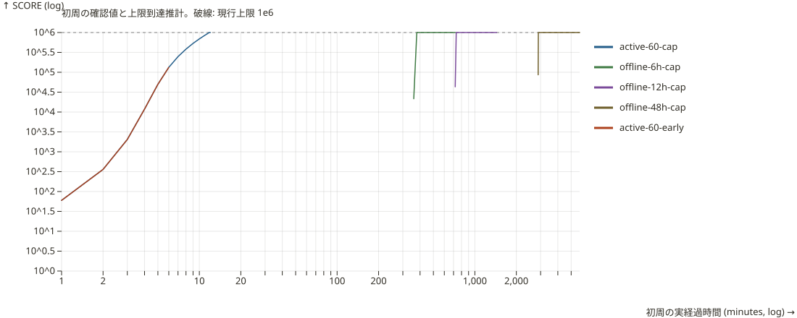
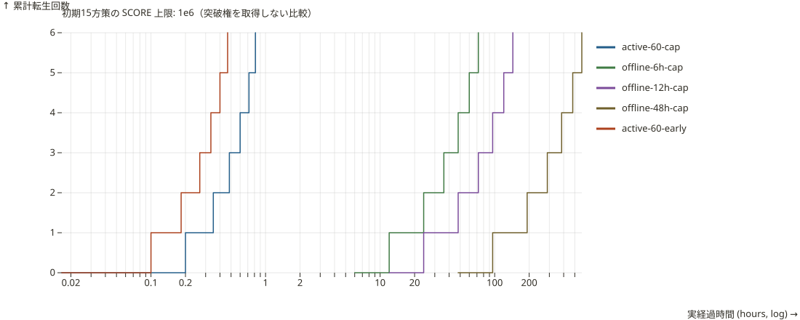
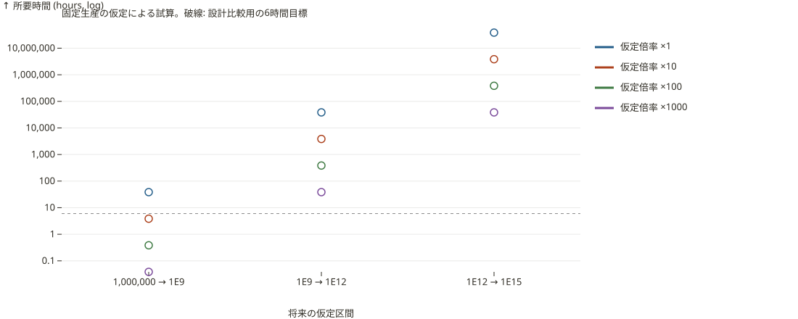
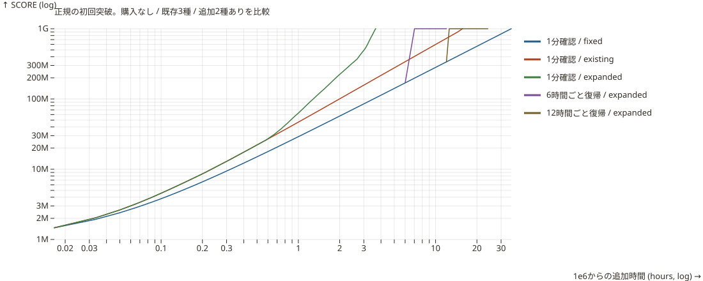
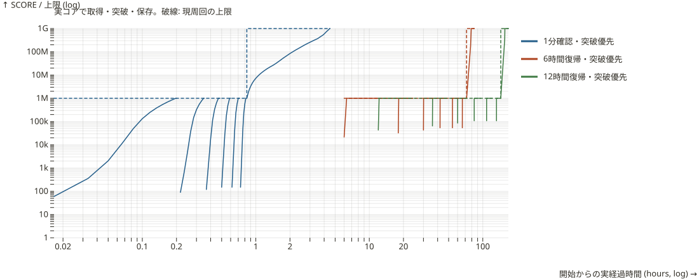
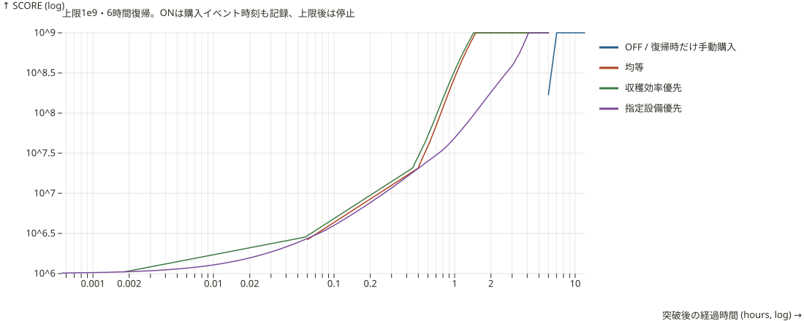

# バランス検証とシミュレーター

[生成レポート](generated/report.md) が基準結果です。[JSON](generated/results.json)・[周回 CSV](generated/runs.csv)・[所有数付き時系列 CSV](generated/timeline.csv)・[固定生産試算 CSV](generated/projections.csv)・[上位設備購入比較 CSV](generated/expansion.csv) から追試できます。#4時点の判断材料は [後続Issueの検討記録](follow-up.md)、#19の採用値と変更前後の比較は [設備拡張の仕様](../equipment-growth.md) にまとめています。

## 実行

Node.js 24 と `npm ci` だけで実行できます。ブラウザ、Python、外部 API、秘密情報は不要です。

```sh
npm run simulate
npm run simulate:check
npm run simulate -- --help
npm run simulate -- --scenario active-60-cap --scenario offline-6h-cap --runs 12 --max-days 90 --out .tmp/balance
```

既定は15方策・各6回の転生・実経過90日で打切り、出力先は `docs/balance/generated/` です。`--out` は明示的に指定したディレクトリへ出力します。`--runs` は1〜100、`--max-days` は0超〜365です。打切り・未到達は未到達のまま記録し、0秒や無限時間に置き換えません。オフライン方策は打切り時に予定外の復帰を行いません。

`simulate:check` はファイルを書かずに再計算し、コミット済みの18成果物との一致を確認します。CI でも実行するため、定数・コア・方策を変えた場合は `npm run simulate` で結果を更新し、採用根拠も見直してください。`src/simulation/baseline.ts` は #4 / PR #18 の15方策・6周回の比較用スナップショットで、再生成対象ではありません。別の周回数・途中打切りでは同条件でない前後比較を省略します。

## 計算と方策

シミュレーターは `src/simulation/`、CLI と出力処理は `scripts/` です。実行時にゲーム画面・ブラウザのセーブを変更しません。生産・価格・購入・転生・スキル・保存形式・放置報酬を複製せず、実際の `src/core/` 関数を呼びます。#19では所有数マイルストーンと上位設備のロック条件にも追従しています。

「1分確認」はブラウザを開いたまま1分ごとに購入/転生を判断する方策です。「1日4回復帰」は6時間ずつ非表示/終了し、戻ったときだけ購入/転生します。操作判断と購入は所要時間0として扱います。オンライン中の通信遅延やタップ速度、人が迷う時間は含みません。

- **常時操作**: 次の1台が購入可能になる時刻・SCORE閾値までイベントで進めます。浮動小数点誤差によるゼロ時間ループを避けるため最大 `1e-7` 秒の余裕を加えます。最適化探索や自動購入機能の実装ではありません。
- **回収時間方策（payback）**: 現在買える設備の `価格 / 次の1台による生産増分` が最小のものを1台ずつ選びます。節目で所有済み台数が強化される増分も、コアの `getEquipmentPurchaseGain` により含めます。同率時は設備定義順。将来の高価な設備のために待つ最適計画ではありません。
- **上位設備優先**: 買える中で設備定義の後ろの設備を選びます。設備を上位まで貯める戦略ではありません。
- **転生方策**: 確認したときに10万以上なら早期転生、または100万に到達したら上限転生。復帰時に上限へ達していれば「早期方針」でも2ptです。
- **スキル投資**: 収穫優先・割引優先・初期所持芋優先・温存の固定計画を比較します。次に予定したランクを買えなければ貯めます。前提・費用・効果は実コアによります。開始時の支給芋は次回の転生から有効です。

方策の定義は `src/simulation/scenarios.ts` / `policies.ts` にあります。確認頻度を高くすると局所的な小額購入も増えるため、常時操作が必ず1分確認より速いとは限りません。#19でも初周は12.29分と12分で逆転しました。「操作が多いほど有利」という単調性や最適性を結果から主張しないでください。

## 時刻・上限・再現性

`productionSeconds` は24時間で制限した生産時間の累計上で、SCOREに到達する時刻を計算したものです。`observedSeconds` は方策が実際に確認した実経過時刻です。オフライン報酬は復帰時にまとめて精算され、到達推計時刻に手動購入や転生を挿入しません。

`cap-reached` は一定の生産力から推計した上限到達です。図ではそこから復帰までの上限停止を示します。48時間放置の場合は最初の24時間を反映対象とした生産時間換算の配置で、実世界のいつ報酬が生まれたかを観測したものではありません。図の確認サンプル間を結ぶ線は、操作頻度や中間の自動購入を追加する意味ではありません。

初回15分の比較は、転生を抑止して最大15分または上限到達までを測ります。復帰予定が15分より後なら未観測です。通常の6周比較とは別の測定なので、早期方策の「15分測定」で100万に届いていても矛盾しません。

時計・乱数・localStorage を使わず、入力から決定的に計算します。JSON は表示上の浮動小数点端数を12有効桁に正規化し、CSV は計算値を保持します。元のコア/定義ファイルは改行を LF 正規化して SHA-256 を記録します。出力に実行日時・ローカルパス・Gitコミット番号を含めません。

## 可視化





初期15方策は突破権を取得しない比較として維持し、全トレースに `scoreCap=1e6` を記録します。`timeline.csv` で上限・全5設備の所有数を確認でき、この15方策の上位2設備の所有は0です。正規突破は別の5経路として検証します。







SVG は [Observable Plot の document オプション](https://observablehq.com/plot/features/plots#plot-options) と既存の jsdom で生成します。独立した SVG なので外部スクリプトなしで参照・共有できます。実測方策と仮定による試算は図も分けています。

## 未確定の範囲

#23の自動購入は [24比較CSV](generated/automation.csv)・[購入イベント時系列](generated/automation-timeline.csv)・[12取得経路CSV](generated/automation-journeys.csv)・[比較図](generated/automation.svg) を追加しています。比較は2段階×1分/6h/12h×OFF/3方針で、段階内の開始状態を統一します。OFFは確認時だけ手動購入、ONは実コアのイベント精算だけです。別途、解禁1ptを支払う初期からの経路も比較します。コアが返すイベント時刻から上限停止・閾値到達を計算し、一定生産の外挿は使いません。[自動購入仕様・採用根拠](../automation.md) を参照してください。



固定生産試算（`projections.csv`）は1e9 / 1e12 / 1e15について、上限だけを変えた所要時間と、6時間で到達するために必要な生産量を計算します。この計算には設備の追加購入を含めません。

正規突破経路（`breakthrough.csv` / `breakthrough-timeline.csv`）は、初期状態からスキル・通常転生・突破権・同一周回の1e9到達を検証します。突破優先の1分/6時間/12時間、1分の早期転生、既存スキル買切り後という5経路です。`max-days` を経路全体の打切りに使い、未到達ならそのまま記録します。`runs` は初期15方策の周回数で、突破経路の取得回数は実際の条件から決まります。条件・採用値・時間は [初回限界突破](../breakthrough.md) にまとめています。

正規1e9の購入比較（`expansion.csv` / `expansion-timeline.csv`）は、1分確認・突破優先経路の実際の突破直前状態に `performBreakthrough` を実行し、購入なし / 既存3種 / 全5種を1分・6時間・12時間で比較する9ケースです。7日で打ち切り、突破後に転生しません。JSONには `assumed: false` / `actualSaveSupported: true` を記録し、全オフライン方策が現行v5セーブ・復元・24時間制限を通ります。権利取得前に打ち切った場合は設備比較を生成しません。#19の `EconomyContext` による仮定は削除しました。

固定生産の感度分析は、正規の突破・購入経路とは別の比較です。研究・上位段階ボーナスなど未実装機能を含む将来の確定予測や「この設備数が必須」という結論には使えません。

深度・掘削スキル・自動購入・2回目以降の上限突破・上位転生・SCORE消費装備・モード変更・クリック補助は未モデル化です。`core` / `projection` / `not-modeled` の区分をJSONとレポートに残しています。#7/#8 の初回到達・倍率過剰・構成最適化は、将来仕様とコアが実装されたときに追加してください。今回の結果を後期成長まで検証済みとは扱いません。

## 検証

`npm test` で無購入の解析解、確認前の転生禁止、オフライン上限、SCOREクリップ、保存往復、決定性、打切り、不正入力を確認します。`npm run simulate:check` がモデル変更時の数値/図の差分を CI で検出します。ゲーム本体のテスト・ビルドも継続します。
